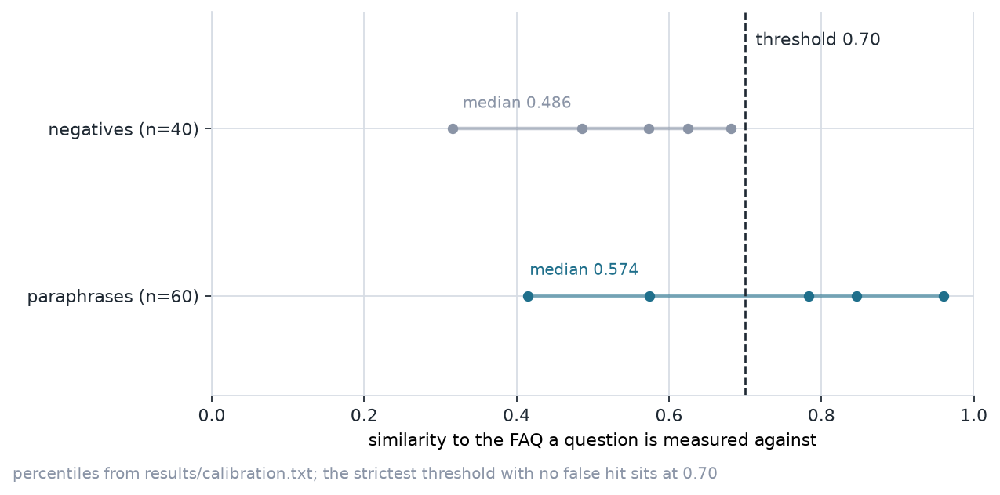
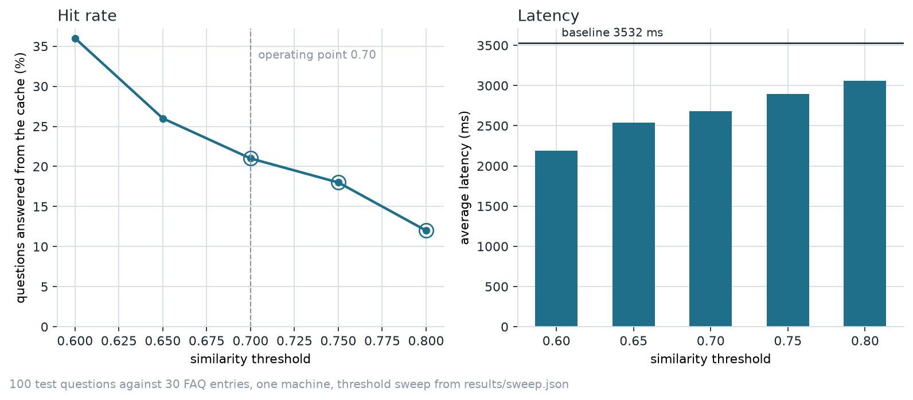

# FAQ semantic cache

[](https://github.com/Bakkarranna/faq-semantic-cache/actions/workflows/ci.yml)
[](https://github.com/Bakkarranna/faq-semantic-cache/actions/workflows/pages.yml)

A semantic cache for an e-commerce support bot. A repeat question is answered
from a vector cache when the meaning of the new question matches a stored
question; a negated question is answered by the LLM with the cache skipped;
everything else goes to the LLM.

The cache answers 21 of 100 test questions itself, in 31 to 56 ms, and serves
none of the 40 questions that have no answer in the FAQ set. Every number in
this report was measured on one machine and written to `results/` by the
scripts in `scripts/`. Nothing here is estimated.

## What the numbers are

The test set is 100 labelled questions: 60 paraphrases that one of the 30 FAQ
entries answers, and 40 questions no FAQ covers. The baseline asks all 100
questions of a local `qwen2.5:1.5b` model through Ollama with the cache
bypassed. The cache run then asks the same 100 questions at five similarity
thresholds.

| | no cache | cache at 0.70 |
| --- | --- | --- |
| answers from the LLM | 100 of 100 | 79 of 100 |
| average latency | 3532 ms | 2682 ms |
| tokens spent | 9919 | 21 calls fewer |
| slowest question | 14649 ms | see log |

A hit is timed directly, at an average of 39.7 ms. A miss is charged both the
cache lookup and the LLM time that the baseline measured for that same
question, so a miss is never reported as optimistic. The average latency of the
cache run, 2682 ms against 3532 ms, is a 1.32x improvement built almost
entirely out of the 21 hits.

The three slowest baseline questions are worth naming, because they are the
shape of the latency the cache exists to remove: `How many days will my parcel
take to arrive?` at 14649 ms, `how do I get a tax invoice with GSTIN` at
13755 ms, and `is the website currently down` at 8155 ms.

## Threshold sweep

Five thresholds, the same 100 questions at each one, with a false hit counted
whenever a question no FAQ covers was served from the cache.

| threshold | hit rate | false hits | wrong FAQ | average latency | LLM calls |
| --- | --- | --- | --- | --- | --- |
| 0.60 | 36.0% | 8 of 40 | 0 | 2192 ms | 64 |
| 0.65 | 26.0% | 1 of 40 | 0 | 2537 ms | 74 |
| **0.70** | **21.0%** | **0 of 40** | **0** | **2682 ms** | **79** |
| 0.75 | 18.0% | 0 of 40 | 0 | 2892 ms | 82 |
| 0.80 | 12.0% | 0 of 40 | 0 | 3060 ms | 88 |

0.70 is the operating point: the highest hit rate among the thresholds that
served no negative question from the cache. 0.65 was rejected because it served
one negative question wrongly, and 0.75 and 0.80 gave up hit rate without
buying any accuracy. No threshold in the sweep served a paraphrase the wrong
FAQ.

The grid is wider than the usual 0.75 to 0.95 because the calibration placed the
decision boundary lower than that: on the measured similarities, a grid that
starts at 0.75 caps the hit rate at 18% without ever reaching the value where
the negative distribution ends.

## Where the boundary actually is

`scripts/calibrate.py` loads the embedding model on its own and measures two
similarity distributions without timing any LLM call: a paraphrase against the
FAQ it answers, and a negative question against its nearest FAQ.

| group | n | median | p75 | p90 | max |
| --- | --- | --- | --- | --- | --- |
| paraphrase to its FAQ | 60 | 0.574 | 0.783 | 0.846 | 0.960 |
| negative to nearest FAQ | 40 | 0.486 | 0.573 | 0.625 | 0.681 |

The negative distribution ends at 0.681, so 0.70 is the strictest threshold with
no false hit anywhere in the test set. The paraphrase distribution has its
median below the threshold, which is why the hit rate is a fifth of the
questions rather than most of them: this embedder separates the two groups
cleanly at the top but places half of the paraphrases in the same band as the
negatives. The nearest FAQ was the correct one for 42 of the 60 paraphrases at
rank one.

The two distributions, with the operating point marked:





## The negation guard

A negated question asks a different thing from the FAQ it resembles. `the
payment did not go through` scores highly against the FAQ that answers what to
do when a payment fails, and serving that answer would be wrong, so a question
carrying a negation word goes to the LLM with the cache skipped entirely.

| question | word found | outcome | time |
| --- | --- | --- | --- |
| the payment did not go through | not | refused | 0.29 ms |
| refund nahi milega kya | nahi | refused | 0.23 ms |
| mujhe refund nahi chahiye | nahi | refused | 0.22 ms |
| mera parcel kabhi nahi aaya | nahi | refused | 0.25 ms |
| I do not want to return this, can I exchange instead | not | refused | 0.33 ms |

Five of the 100 test questions match the guard and none of them is answered
from the cache: zero negated hits out of five. The guard costs a fraction of a
millisecond because it needs no embedding.

One of the five is a paraphrase of an FAQ. `the payment did not go through` is
a reworded way of asking what a failed payment means for an order, which is
what FAQ-14 answers. The guard refuses it before the index is consulted, so the
sweep recorded 21 hits where the calibration counted 22 for the same threshold:

```
calibration, t=0.70:  paraphrase hits 22/60, false hits 0
sweep log,    t=0.70:  hits 21, misses 74, refused 5
```

The one-question difference is the guard working as intended. The calibration
measured embedding similarity alone and never applied the guard, so it is the
conservative count of the two.

## One conversation, end to end

`scripts/demo.py` asks three questions of a warm cache and prints what the user
gets. The questions were chosen by measuring embedder similarities before the
run, so the outcomes below are what the run produced rather than what it was
meant to produce.

| question | outcome | similarity | latency |
| --- | --- | --- | --- |
| do you have a loyalty programme for regular customers | miss, answered by the LLM, stored | 0.462 | 1878 ms |
| what loyalty benefits do regular customers get | hit, served from the stored answer | 0.850 | 70 ms |
| I do not want to return this, can I exchange instead | refused, cache skipped, LLM answered | — | 1705 ms |

The first question scores 0.462 against its nearest FAQ, below the threshold, so
it is a real miss. The rewording scores 0.850 against the answer that question
stored, so the second is answered from the cache in 70 ms and the LLM is not
called at all. The model was loaded before the sequence began, so the 1878 ms
of the first step is the model answering rather than the weights loading. The
third question is refused by the guard and still gets a correct answer from the
model, which is what a support desk needs. The run writes `results/demo.json`.

## How the cache works

1. **Normalise and guard.** The question is lower-cased and scanned for negation
   words in English and in Hinglish, because the FAQ set covers both. A match
   ends the lookup and the question goes straight to the LLM.
2. **Embed.** The question is encoded with
   `sentence-transformers/paraphrase-multilingual-MiniLM-L12-v2` at 384
   dimensions, which fits on a machine with 8 GB of RAM alongside the LLM.
   The weights are loaded shard by shard to keep the peak allocation within
   that budget.
3. **Search.** The store is a FAISS inner-product index over normalised vectors,
   so cosine similarity is an index search rather than a linear scan, and it
   returns the nearest stored question.
4. **Decide.** The nearest similarity is compared with the operating threshold.
   At or above it the stored answer is served; below it the question goes to
   the LLM.
5. **Write back.** A miss the LLM answered is stored against its own embedding,
   so the next similar question can hit, unless the question looks like user
   data. A miss that matched an FAQ above the threshold refreshes that FAQ's
   answer.

Every request is logged as one JSON line with the question, the outcome, the
similarity that produced it, the latency and the answer length. No answer text
and nothing customer-specific is written to the log.

## Layout

```
data/faqs.json        30 FAQ entries, English and Hinglish
data/test_set.json    100 labelled questions: 60 paraphrases, 40 negatives
src/faqcache/
  config.py           thresholds, models, FAQ paths, negation word list
  embeddings.py       sentence-transformers wrapper, loaded shard by shard
  store.py            FAISS index and nearest-neighbour search
  guard.py            negation detection
  cache.py            the decision path: guard, search, threshold, write-back
  llm.py              Ollama client
  logging.py          JSONL request log
scripts/
  run_evaluation.py   baseline phase, threshold sweep, request log
  calibrate.py        similarity distributions, no LLM call
  pick_negation_examples.py
  smoke_embeddings.py
  make_figures.py     regenerates the figures from results/
  demo.py             the three-question conversation
tests/               44 unit tests, 9 integration tests
results/             measured artifacts, one JSON per phase
docs/                GitHub Pages report
```

## Running it

```bash
pip install -r requirements.txt
ollama serve                                  # or the Ollama desktop app

python scripts/run_evaluation.py --phase baseline   # ~6 min
python scripts/run_evaluation.py --phase sweep      # ~25 min
python scripts/calibrate.py
python scripts/make_figures.py
python scripts/demo.py --json results/demo.json
```

The two phases are separate commands because a machine with 8 GB of RAM cannot
hold the embedding model and the 1.5B LLM at the same time. The baseline phase
loads no embedding model and the sweep phase makes no LLM call: a miss is
charged the LLM time the baseline measured for that same question. The split is
about memory, not about hiding a timing. The numbers land in
`results/baseline.json`, `results/sweep.json` and `results/summary.json`.

The measurements were taken on Python 3.13 with sentence-transformers 6.2.0,
FAISS on CPU, and `qwen2.5:1.5b` served by Ollama on 127.0.0.1:11434 at
temperature 0.

## Checks

```
pytest tests/unit -q          44 passed
pytest tests/integration -q  9 passed, 21 paraphrase hits of 60
ruff check .                 clean
```

The unit tests use a deterministic embedder so they run without the model. The
integration tests load the real model and walk the three outcomes, the guard
and the logging path, and they fail rather than skip when the embedder cannot
load. Both families run in GitHub Actions on every push to `main`; the unit
suite is the required check and the model jobs confirm the real embedder still
separates the test set.

## Limits worth stating

- A 21% hit rate is a property of this test set and this embedder as much as of
  the threshold. Half the paraphrases score below 0.70, so this cache catches
  near-identical rewordings rather than any phrasing.
- The threshold was chosen on the same 100 questions it was evaluated on, so it
  describes this set rather than predicting traffic.
- The cache holds answers in memory only. A restart starts from the FAQ set
  again and nothing persists to disk.
- The sweep phase made no LLM call, so the cached run has no token figure; the
  9919 tokens quoted are the baseline's.

The report is published as GitHub Pages from `docs/`:
<https://bakkarranna.github.io/faq-semantic-cache/>

