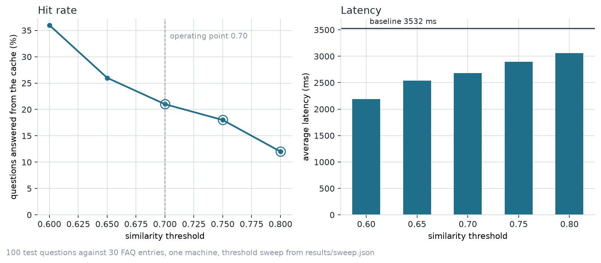
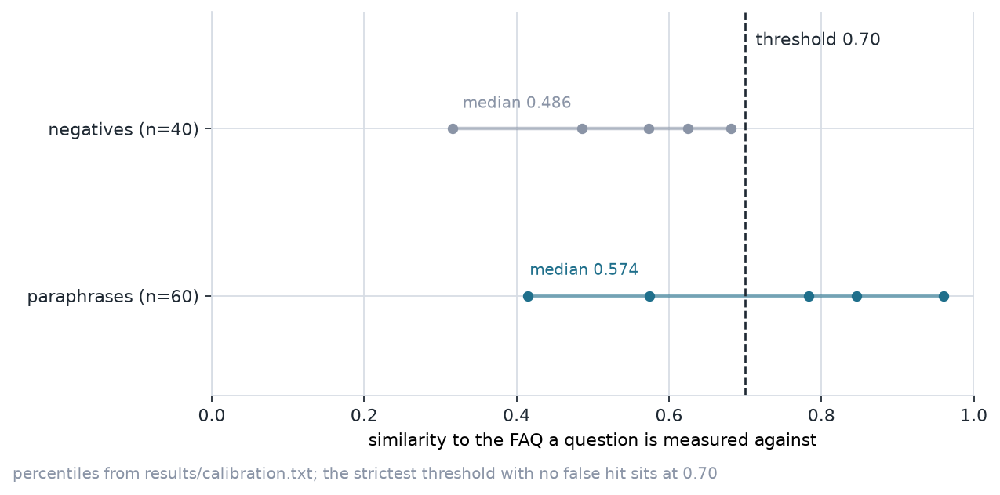

# FAQ semantic cache: measured results

A support bot that answers a repeat question from a vector cache when the
meaning of the new question matches a stored one, and sends everything else to
an LLM. All 1,000 test questions were asked of a local `qwen2.5:1.5b` model through
Ollama, and every number below comes from the artifacts of one run rather than
an estimate.

## What the cache changes

| | no cache | cache at 0.80 |
| --- | --- | --- |
| answers from the LLM | 1,000 of 1,000 | 804 of 1,000 |
| average latency | 5270 ms | 4290 ms |
| time on a cache hit | n/a | 81.6 ms on average, 264.6 ms slowest |
| tokens spent | 98,826 | not measured, the sweep made no LLM call |

The cache answered 196 of the 1,000 questions itself, against 300 FAQ entries:
600 of the questions are paraphrases one FAQ should answer and 400 are
questions no FAQ covers. The 804 misses still go to the model, which is the
honest price of a threshold that refuses to answer a question it is not sure
about. The three slowest questions without a cache took 19.2 s, 19.0 s and
18.3 s, which is the shape of latency the cache removes.

## Threshold sweep

Five thresholds, 1,000 questions at each, false hits counted against the 400
questions no FAQ covers.

| threshold | hit rate | false hits | wrong FAQ | average latency | LLM calls |
| --- | --- | --- | --- | --- | --- |
| 0.60 | 47.2% | 100 of 400 | 55 | 2955 ms | 528 |
| 0.65 | 38.0% | 55 of 400 | 40 | 3374 ms | 620 |
| 0.70 | 31.5% | 31 of 400 | 29 | 3736 ms | 685 |
| 0.75 | 25.1% | 11 of 400 | 16 | 4055 ms | 749 |
| **0.80** | **19.6%** | **2 of 400** | **5** | **4290 ms** | **804** |

0.80 is the operating point. No threshold on the grid served none of the 400
negative questions, so the rule that picked it is a stated budget rather than a
measured clean cut: a threshold is eligible when a false hit stays within one
in a hundred negatives, and the hit rate decides between the eligible ones.
Only 0.80 qualifies, at 0.5%. `choose_threshold` over the committed
`results/sweep.json` returns 0.80, so the number in `results/summary.json` is
reproducible from the committed record.

## Why the hit rate is not higher

The similarity of a paraphrase to the FAQ it answers and the similarity of an
unrelated question to its nearest FAQ were measured separately, so the two
distributions could be placed on one scale.

| group | n | p25 | p50 | p75 | p90 | max |
| --- | --- | --- | --- | --- | --- | --- |
| paraphrase to its FAQ | 600 | 0.478 | 0.678 | 0.848 | 0.935 | 0.996 |
| negative to nearest FAQ | 400 | 0.461 | 0.529 | 0.610 | 0.687 | 0.871 |

The negative distribution reaches 0.871 while the paraphrases start at 0.478,
so the two groups overlap and no threshold separates them. The paraphrase
median, 0.678, sits below the operating point, so half of the paraphrases never
reach the cache; the nearest FAQ was the correct one for 424 of the 600 at rank
one.

## The negation guard

45 of the 1,000 questions carry a negation word. The cache answers none of them,
zero cached answers out of 45, matching the pattern zero, because a negated
question asks a different thing from the FAQ it resembles and a cache cannot
tell the two apart. 32 of the 45 are paraphrases of an FAQ, including `the
payment did not go through`, and the guard refuses every one.

The calibration measured embedding similarity alone and never applied the guard,
so it counted 201 paraphrase hits and 3 false hits at 0.80 where the measured
sweep counted 194 paraphrase hits and 2 false hits. The difference of five
paraphrase hits and one false hit is the guard working as intended.

## One conversation

The demo asks three questions of a warm cache. The reworded question clears the
threshold against the answer the cold question stored, and the negated question
is answered by the model with the cache skipped.

| question | outcome | similarity | latency |
| --- | --- | --- | --- |
| item nakli lage to kya karna hota hai | miss, answered by the LLM and stored | 0.320 | 3425 ms |
| seller nakli item bhej de to kya hota hai | hit, served from the stored answer | 0.940 | 82 ms |
| the payment did not go through | refused, cache skipped, LLM answered | — | 5745 ms |

Both figures regenerate from the measured artifacts with
`scripts/make_figures.py`.

## Served status

The GitHub Pages URL was requested when this report was regenerated and
answered HTTP 200 at 2026-11-07T20:25:07Z, so the site is being served and
this committed copy is the record. The status is stored with the measured
numbers as `pages_status` in `results/summary.json` and is refreshed by
`scripts/check_pages.py`.

The full report, the test set and the scripts that produced every number are in
the repository: [faq-semantic-cache](https://github.com/Bakkarranna/faq-semantic-cache).
